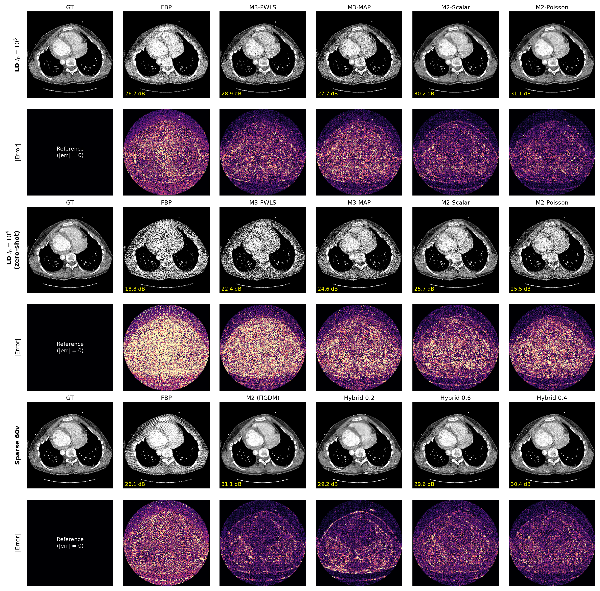
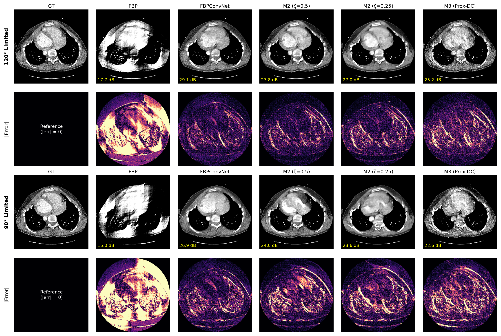

# How Should Measurements Enter Flow-Matching ODE Sampling?

**测量应如何进入流匹配 ODE 采样？稀疏视角、限角与低剂量 CT 的严格对照研究**

张伟豪（Weihao Zhang）· 河北大学 · 20268018055@stumail.hbu.edu.cn

论文：[英文版 PDF](paper/main.pdf) · [中文版 PDF](paper/main_zh.pdf) · LaTeX 源码见 [`paper/`](paper/) · 最新版本：[Release v1.2-track1](https://github.com/ZeroDevi1/flow-ct-guidance/releases/tag/v1.2-track1)

---

## 2026-10-31 新增：P0/P1 开发验证复现材料

本轮复用冻结流先验，在 **20 名开发验证患者 × 2 张切片 × 3 个种子**上完成低剂量 P1，并训练/评估匹配设置的 FBP 残差 U-Net。**不是新的独立测试，也不替换下方历史 Phase 1 test200 结果。** 本轮没有读取剩余 37 名验证患者或 89 名测试患者的图像；历史 test200 已查看这一事实不变。

| 本轮固定设置（180 角、I0=1e5） | 患者宏平均 PSNR / dB | SSIM |
|---|---:|---:|
| FBP | 27.2668 | 0.61724 |
| DC，λ=3，NFE50 / CG30 | 25.8361 | 0.57170 |
| 观测计数 WLS，λ=0.3，NFE50 / CG30 | 31.7144 | 0.72342 |
| FBP 残差 U-Net，20k 步 best | **37.2846** | **0.91129** |

WLS 在本配置下强于 DC，但仍落后匹配监督基线；DC 甚至低于 FBP，因此不能只展示 WLS/DC 差值来宣称先进性。20k 是训练上限，**不是已证明收敛**。同图 NFE20→50 出现退步，原始 GPU 数值控制失败也完整保留；固定每步 λ 不保证 NFE 变化时总引导作用不变。

- [本轮证据、隐私边界与复现入口](results/2026-10-31-budget-p1/README.md)
- [P1 完整报告](code/experiments/budget_pilot/P1_RESULT_20261031.md) · [强基线与负结果](code/experiments/budget_pilot/BASELINE_RESULT_20261031.md)
- [实验代码与安全运行说明](code/experiments/budget_pilot/README.md) · [更新后的 Roadmap](ROADMAP.md)

## 这项工作做了什么

已发表的 CT 流匹配重建方法往往**同时**改变了先验、网络、数据和"测量如何注入采样过程"这一规则，因此很难判断到底是哪一项在起作用。本工作**固定其他一切，只改变注入规则**：

- **同一个先验**：在公开的 TotalSegmentator CT 上训练的 19.8M 参数 rectified flow U-Net（1228 例，官方按病人划分，12 万步）
- **三种注入规则**，放在同一个 Euler ODE 积分器里：
  - **M1 梯度引导**（DPS 式）
  - **M2 伪逆引导**（ΠGDM 式）
  - **M3 近端数据一致性**（DDS / DDNM 式）
- **对照基线**：FBP，以及同骨干的监督网络 FBPConvNet
- **评测设置**：30 / 60 / 90 视角稀疏采样，低剂量 I0 = 1e5 / 1e4（平行束仿真）
- **统计方法**：引导强度采用与步数、视角数无关的单位，只在验证集病人上调参；所有比较都给出按病人聚类的 bootstrap 95% 置信区间

## 主要结果（test200 = 20 位测试病人 × 10 张，NFE 50，PSNR / dB）

| 设置 | FBP | FBPConvNet | M1 DPS | M2 ΠGDM | M3 Prox-DC | Track 1 扩展（Hybrid / Poisson） |
|---|---:|---:|---:|---:|---:|---:|
| 30 视角 | 23.50 | 32.22 | 24.40 | 32.17 | 31.62 | **33.99**（Hybrid $t_{\text{sw}}{=}0.4$） |
| 60 视角 | 28.50 | 35.50 | 24.54 | 36.93 | 35.95 | **37.63**（Hybrid $t_{\text{sw}}{=}0.4$，LPIPS 0.069） |
| 90 视角 | 30.58 | 37.41 | 24.54 | 38.09 | 38.62 | **38.99**（Hybrid $t_{\text{sw}}{=}0.4$） |
| 限角 120° | 19.09 | **32.44** | — | 29.15 ($\zeta{=}0.25$) | 29.32 | 无条件最优 29.32（M3 稳态，DC 紧 3.3×） |
| 限角 90° | 16.04 | **29.98** | — | 24.68 ($\zeta{=}0.25$) | 24.38 | 无条件最优 24.68（M3 稳态，DC 紧 2.6×） |
| 低剂量 $I_0{=}10^5$ | 26.21 | 35.32 | 24.55 | 33.16 | 30.60 | **35.60**（M2-Poisson，LPIPS 0.079）；M3-PWLS 32.44 |
| 极端低剂量 $I_0{=}10^4$（零样本） | 18.03 | — | 24.50 | 22.53 | 20.63 | **30.18**（M2-Poisson，+7.65 dB）；M3-MAP **28.41**（+7.78 dB） |

- **早 M3 晚 M2 混合调度（$t_{\text{sw}}{=}0.4$）横扫全部稀疏视角单样本最优**：30/60/90 视角分别达到 **33.99 / 37.63 / 38.99 dB**，超纯 M2 `+0.71` 至 `+1.82 dB`（60 视角 CI `[+0.20, +1.29]`）、超同骨干监督基线 FBPConvNet `+1.59` 至 `+2.14 dB`（60 视角 CI `[+1.37, +3.03]`），同时相对纯 M2 降低 37% LPIPS 并提速 **14.6%**（同卡 A100 耗时 `2.12` vs `2.48 min`）。
- **解析逐射线 Poisson 建模（$\Sigma_y/r_t^2$ + Jacobi PCG）彻底逆转低剂量短板**：`M2-Poisson` 在纯解析倍率（$\alpha{=}1.0$）下于 $I_0{=}10^5$ 达到 **35.60 dB / LPIPS 0.079**（较无噪 M2 提升 `+2.44 dB`，CI `[+2.03, +2.91]`；PSNR 与 LPIPS 双双反超监督基线 FBPConvNet 的 `35.32 dB / 0.088`），并零样本迁移至 $I_0{=}10^4$ 达到 **30.18 dB**（`+7.65 dB`）；贝叶斯 `M3-PWLS-MAP`（$\lambda_0/r_t^2$）在 $I_0{=}10^4$ 同样实现 **`+7.78 dB`** 零样本跃升（`28.41 dB`）。
- **限角复核与完整 6 协议监督基线**：向低值扩展限角 M2 网格发现位于 $\zeta{=}0.25$ 的狭窄内点峰（`la120` 29.15 dB、`la90` 24.68 dB），复核后 M2 与 M3 统计持平但 M2 在 $\zeta{\ge}0.5$ 即发生陡峭失稳，而 M3 在两个数量级上平坦稳定且 DC 紧 3–4 倍；补齐后的限角监督基线 FBPConvNet 达 `32.44 dB`（120°）与 `29.98 dB`（90°），量化出无条件流先验在大缺失扇区仍存在 3.1–5.3 dB 缺口。
- **M3 步数效率与后验均值最优、M1 终版权重失效诊断**：M3 20 步即达 36.23 dB，60 视角 $K{=}8$ 后验均值达 **39.41 dB**（超 FBPConvNet `+3.92 dB`，CI `[2.97, 4.95]`）；在最终 120k 先验上复测确认 M1 在 $t{=}0$ 处存在 **15.6×** 梯度尖峰（RMS 1.41 vs 后期均值 0.090），导致流 ODE 上饱和在 ~24.5 dB。
- **Phase 1b 采样器内一维正弦图补全探针**：2.57M 一维角度 SSM（融合 Triton 核 45× 加速）未超越二维图像先验自身投影（60 视角 `+0.007 dB`，120° `-0.028 dB`），已止损归档。

<p align="center"></p>
<p align="center"></p>

矢量分析图见 [`track1_solvers.pdf`](paper/figures/track1_solvers.pdf)、[`m1_grad_120k.pdf`](paper/figures/m1_grad_120k.pdf) 与 [`architecture.pdf`](paper/figures/architecture.pdf)；完整的数值、置信区间和配对检验见 [`results/analysis.json`](results/analysis.json)、[`results/phase1b/bootstrap_summary.json`](results/phase1b/bootstrap_summary.json) 与 [`results/track1/bootstrap_summary.json`](results/track1/bootstrap_summary.json)。

## 仓库结构

```
paper/                 中英文论文（LaTeX 源码、编译好的 PDF、参考文献、图表）
code/
  src/                 物理算子（可微 Radon / FBP / CG 一致性 / HLCC）、数据处理、模型、训练、后验采样
  configs/             全部实验配置（先验、评测、FBPConvNet；Phase 1b 补全器）
  scripts/             实验矩阵编排（run_matrix.py）、统计分析与作图（analyze.py）、流水线脚本
  tests/               单元测试（Radon 伴随与 FBP、HLCC、角度 SSM、全角度加权 DC）
  env/                 AutoDL 环境脚本与 requirements
results/               每个实验的 metrics.json / per_image.csv / config.yaml / 示例图，以及先验训练日志与采样图
docs/                  实验设计、新颖性核查、Phase 1b 设计、周报
```

## 模型权重

训练好的权重发布在 [Release v1.0-phase1](https://github.com/ZeroDevi1/flow-ct-guidance/releases/tag/v1.0-phase1) 与 [Release v1.1-phase1b](https://github.com/ZeroDevi1/flow-ct-guidance/releases/tag/v1.1-phase1b)，均附有 `SHA256SUMS.txt`：

| Release / 文件 | 内容 |
|---|---|
| `v1.0-phase1` · `prior_256_ema_final.pt` | 流匹配先验，19.8M 参数，12 万步的 EMA 权重 |
| `v1.0-phase1` · `fbpconvnet_{sv30,sv60,sv90,ld1e5}.pt` | 各采集协议下的 FBPConvNet 基线，各训练 10k 步 |
| `v1.1-phase1b` · `completer_ssm_15k.pt` | Phase 1b 双向角度序列 SSM 正弦图补全器，2.57M 参数，15k 步权重及训练/验证日志 |

有了先验权重，就**不需要重新训练**，可以直接做后验采样实验。把它放到 `code/checkpoints/prior_256/ema_final.pt`，然后跳过下面复现步骤中的第 4 步。

### 2026-10-31 完整续训断点 / Full training checkpoints

本轮匹配低剂量 FBP 残差 U-Net 的原始完整断点已发布在 [Release v1.1-p1-dev-20261031](https://github.com/ZeroDevi1/flow-ct-guidance/releases/tag/v1.1-p1-dev-20261031)（预发布）。它们与上面的历史 Phase 1 推理权重用途不同，不能混用实验结论。

The original full checkpoints of the matched low-dose FBP residual U-Net are available in [Release v1.1-p1-dev-20261031](https://github.com/ZeroDevi1/flow-ct-guidance/releases/tag/v1.1-p1-dev-20261031) (pre-release). These are distinct from the historical Phase 1 inference weights above.

| 文件 / File | 内容 / Contents | 大小 / Bytes |
|---|---|---:|
| `best.pt` | 本轮最佳开发验证断点，含完整训练状态 / Best development-validation checkpoint with full training state | 238,285,915 |
| `last.pt` | 本轮最后一步完整续训断点 / Last-step checkpoint for resuming training | 238,285,915 |
| `checkpoint_manifest_nonprivate.json` | 文件大小与 SHA-256 校验清单 / File sizes and SHA-256 manifest | 252 |

两个断点均保留模型、优化器、随机数（RNG）、配置及训练进度，也保留公开数据集的队列/切片索引和通用数据路径；没有打包原始 CT 图像。它们来自同一批开发验证，训练达到 20,000 步上限，不代表已经收敛、独立测试通过或达到 SOTA。下载后先核对 Release 显示的 SHA-256；完整训练格式只能在信任来源时加载，不能因为文件名相同就反序列化任意 checkpoint。

Both files retain the model, optimizer, RNG, configuration and training progress, including public-dataset cohort/slice indices and a generic data path, but no raw CT images. The run reached its 20,000-step cap; it does not establish convergence, independent-test performance or SOTA. Verify SHA-256 before loading, and only deserialize trusted checkpoints.

数据来源、许可和完整哈希见 [发布范围与数据署名](results/2026-10-31-budget-p1/CHECKPOINT_PUBLICATION.md)；复现与安全运行参见 [实验 README（英文原文与中文对照）](code/experiments/budget_pilot/README.md)。

## 复现

```bash
# 1. 环境（PyTorch ≥ 2.3；在 AutoDL 的 PyTorch 2.12 / CUDA 13 镜像上验证过）
pip install -r code/env/requirements.txt
cd code && export PYTHONPATH=$PWD

# 2. 数据：TotalSegmentator v2.0.1（CC-BY-4.0），这里用 HF 上的重新打包版本
#    https://huggingface.co/datasets/YongchengYAO/TotalSegmentator-CT-Lite （Images.zip 与 meta.csv）
python src/data/prepare_slices.py --raw <解压后的目录> --out <processed 目录> --max-per-case 40
# 日志应显示 "meta.csv 划分匹配 1228/1228 例"；同时生成固定评测集 slices_test200.npy

# 3. 单元测试
python tests/test_radon.py && python tests/test_hlcc.py && python tests/test_angle_ssm.py && python tests/test_dcfull.py && python tests/test_track1.py

# 4. 先验（单张 RTX 5090 约 6.3 小时）
python src/train_flow.py --config configs/prior_256.yaml

# 5. 全部实验矩阵：val 调参 → 选参 → 主表 → NFE → 不确定性 → I0=1e4 → FBPConvNet
python scripts/run_matrix.py --ckpt checkpoints/prior_256/ema_final.pt \
  --stage fbp tune select main nfe unc ld1e4 fbpconvnet
python scripts/collect_results.py
python scripts/analyze.py --results results --index results/index_test200.csv --paper ../paper
```

历史运行资料的来源、旧源码差异、环境快照及权重/数据校验见 [2026-10-30 复现资料恢复记录](docs/reproducibility/2026-10-30/README.md)；这是既有证据归档，不是新增实验结果或完整数据盘备份。

运行前需要把配置里的 `processed_dir` 改成你自己的数据路径。复现的输出会写到 `code/results/` 和 `code/checkpoints/`；仓库根目录下的 `results/` 是本文实际跑出来的结果记录。整个研究约用了 12 个 GPU 小时。

## 局限

- 前向模型是作用在重建体数据上的平行束仿真，没有涉及扇束 / 锥束几何、算子失配和真实投影数据。
- 引导强度在每种噪声情形下只在验证集调一次，再零样本迁移到其他视角数和剂量（$I_0{=}10^4$ 未重调）。
- 全部 6 协议的 FBPConvNet 统一训练 1 万步（约 3.7 epoch，先验约 89 epoch），代表受控预算下的基线而非监督渐近上限。

论文中有完整的讨论。

## 后续路线图（Track 1 已收口，下一步进入 Track 2）

Track 1（Poisson 噪声感知流求解器、早 M3 晚 M2 混合调度、限角 M2 内点复核、限角 FBPConvNet 补齐与 120k 权重 M1 梯度复测）已全部完成并写入终版中英文论文（详见 [`results/track1/`](results/track1/)）。剩余 `133.55 CU` 的 Track 2 规划（2D 条件流 ControlNet/LoRA 门控 + 真实扇束 2DeteCT / 3D 层间一致）见 [`docs/03_roadmap_v2.md`](docs/03_roadmap_v2.md)。

后续研究优先级、阶段验收、数据隔离与新增文献定位见 [Research Roadmap](ROADMAP.md)（2026-10-31 更新）。该路线图补充现有 Phase 1b 设计，新增实验仍为待办。

## 致谢与声明

- 数据：TotalSegmentator（Wasserthal et al., *Radiology: AI* 2023，CC-BY-4.0）。
- 本工作的实验代码、实验执行与论文初稿借助了 AI 编程助手（Claude，Anthropic）完成。全部结果与文字均经作者核查，作者对内容负全部责任。

## 引用

```bibtex
@misc{zhang2026flowctguidance,
  title  = {How Should Measurements Enter Flow-Matching ODE Sampling? A Controlled Study for Sparse-View and Low-Dose CT},
  author = {Zhang, Weihao},
  year   = {2026},
  howpublished = {\url{https://github.com/ZeroDevi1/flow-ct-guidance}}
}
```

