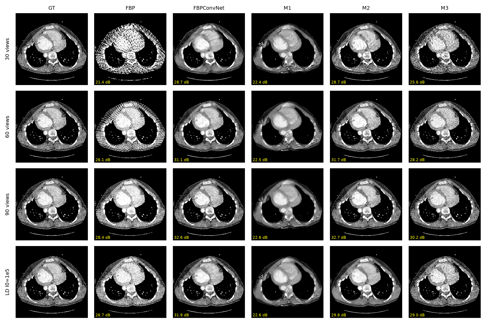

# How Should Measurements Enter Flow-Matching ODE Sampling?

**测量应如何进入流匹配 ODE 采样？稀疏视角与低剂量 CT 的对照研究**

张伟豪（Weihao Zhang）· 河北大学 · 20268018055@stumail.hbu.edu.cn

论文：[英文版 PDF](paper/main.pdf) · [中文版 PDF](paper/main_zh.pdf) · LaTeX 源码见 [`paper/`](paper/)

---

## 这项工作做了什么

已发表的 CT 流匹配重建方法往往**同时**改变了先验、网络、数据和"测量如何注入采样过程"这一规则，因此很难判断到底是哪一项在起作用。本工作**固定其他一切，只改变注入规则**：

- **同一个先验**：在公开的 TotalSegmentator CT 上训练的 19.8M 参数 rectified flow U-Net（1228 例，官方按病人划分，12 万步）
- **三种注入规则**，放在同一个 Euler ODE 积分器里：
  - **M1 梯度引导**（DPS 式）
  - **M2 伪逆引导**（ΠGDM 式）
  - **M3 近端数据一致性**（DDS / DDNM 式）
- **对照基线**：FBP，以及同骨干的监督网络 FBPConvNet
- **评测设置**：30 / 60 / 90 视角稀疏采样，低剂量 I0 = 1e5 / 1e4（平行束仿真）
- **统计方法**：引导强度采用与步数、视角数无关的单位，只在验证集病人上调参；所有比较都给出按病人聚类的 bootstrap 95% 置信区间

## 主要结果（test200 = 20 位测试病人 × 10 张，NFE 50，PSNR / dB）

| 设置 | FBP | FBPConvNet | M1 DPS | M2 ΠGDM | M3 近端 DC |
|---|---|---|---|---|---|
| 30 视角 | 23.50 | **32.22** | 24.40 | 32.17 | 31.62 |
| 60 视角 | 28.50 | 35.50 | 24.54 | **36.93** | 35.95 |
| 90 视角 | 30.58 | 37.41 | 24.54 | 38.09 | **38.62** |
| 低剂量 I0=1e5 | 26.21 | **35.32** | 24.55 | 33.16 | 30.60 |

- **60 视角下 M2 的单样本最好**，比 FBPConvNet 高 +1.43 dB，95% CI [0.95, 1.91]。
- **M3 步数效率最高**：20 步就达到 36.2 dB（200 张图约 36 秒）。**M3 的后验均值也最好**：60 视角取 8 个样本时达到 39.41 dB，比 FBPConvNet 高 +3.92 dB，CI [2.97, 4.95]。
- **M1（DPS 式）在流 ODE 上失效**：无论 30、60 还是 90 视角，都饱和在约 24.5 dB，并会产生解剖结构上的幻觉。
- **低剂量下监督基线仍然更好**（比 M2 高 2.2 dB）。这是在没有给 M2 / M3 显式噪声模型的前提下得到的结论。

<p align="center"></p>

完整的数值、置信区间和配对检验见 [`results/analysis.json`](results/analysis.json) 与 [`results/summary.md`](results/summary.md)。

## 仓库结构

```
paper/                 中英文论文（LaTeX 源码、编译好的 PDF、参考文献、图表）
code/
  src/                 物理算子（可微 Radon / FBP / CG 一致性 / HLCC）、数据处理、模型、训练、后验采样
  configs/             全部实验配置（先验、评测、FBPConvNet；Phase 1b 补全器）
  scripts/             实验矩阵编排（run_matrix.py）、统计分析与作图（analyze.py）、流水线脚本
  tests/               单元测试（Radon 伴随与 FBP、HLCC、角度 SSM、全角度加权 DC）
  env/                 AutoDL 环境脚本与 requirements
results/               每个实验的 metrics.json / per_image.csv / config.yaml / 示例图，以及先验训练日志与采样图
docs/                  实验设计、新颖性核查、Phase 1b 设计、周报
```

模型权重没有放进仓库（先验约 80 MB）。按下面的步骤可以复现。

## 复现

```bash
# 1. 环境（PyTorch ≥ 2.3；在 AutoDL 的 PyTorch 2.12 / CUDA 13 镜像上验证过）
pip install -r code/env/requirements.txt
cd code && export PYTHONPATH=$PWD

# 2. 数据：TotalSegmentator v2.0.1（CC-BY-4.0），这里用 HF 上的重新打包版本
#    https://huggingface.co/datasets/YongchengYAO/TotalSegmentator-CT-Lite （Images.zip 与 meta.csv）
python src/data/prepare_slices.py --raw <解压后的目录> --out <processed 目录> --max-per-case 40
# 日志应显示 "meta.csv 划分匹配 1228/1228 例"；同时生成固定评测集 slices_test200.npy

# 3. 单元测试
python tests/test_radon.py && python tests/test_hlcc.py && python tests/test_angle_ssm.py && python tests/test_dcfull.py

# 4. 先验（单张 RTX 5090 约 6.3 小时）
python src/train_flow.py --config configs/prior_256.yaml

# 5. 全部实验矩阵：val 调参 → 选参 → 主表 → NFE → 不确定性 → I0=1e4 → FBPConvNet
python scripts/run_matrix.py --ckpt checkpoints/prior_256/ema_final.pt \
  --stage fbp tune select main nfe unc ld1e4 fbpconvnet
python scripts/collect_results.py
python scripts/analyze.py --results results --index results/index_test200.csv --paper ../paper
```

运行前需要把配置里的 `processed_dir` 改成你自己的数据路径。复现的输出会写到 `code/results/` 和 `code/checkpoints/`；仓库根目录下的 `results/` 是本文实际跑出来的结果记录。整个研究约用了 12 个 GPU 小时。

## 局限

- 前向模型是作用在重建体数据上的平行束仿真，没有涉及扇束 / 锥束几何、算子失配和真实投影数据。
- 引导强度在每种噪声情形下只调一次，再迁移到其他视角数和剂量；I0=1e4 没有重新调参。
- FBPConvNet 只训了约 3.7 个 epoch（先验约 89 个），因此它的数字是下界。
- 「DPS 梯度沿轨迹变化约 60 倍」这一结论来自中间权重上的初步测量。

论文中有完整的讨论。

## 下一步（Phase 1b，进行中）

方案是在采样器内部用沿投影角度扫描的状态空间模型（SSM）补全正弦图，并输出逐角度置信度来加权全角度数据一致性；再结合 Helgason–Ludwig 一致性条件，并把补全从插值推广到限角外推。设计见 [`docs/02_phase1b_angle_ssm_design.md`](docs/02_phase1b_angle_ssm_design.md)，新颖性核查见 [`docs/02_novelty_check.md`](docs/02_novelty_check.md)。相关代码已经写好，单元测试已通过，还没有在 GPU 上训练。

## 致谢与声明

- 数据：TotalSegmentator（Wasserthal et al., *Radiology: AI* 2023，CC-BY-4.0）。
- 本工作的实验代码、实验执行与论文初稿借助了 AI 编程助手（Claude，Anthropic）完成。全部结果与文字均经作者核查，作者对内容负全部责任。

## 引用

```bibtex
@misc{zhang2026flowctguidance,
  title  = {How Should Measurements Enter Flow-Matching ODE Sampling? A Controlled Study for Sparse-View and Low-Dose CT},
  author = {Zhang, Weihao},
  year   = {2026},
  howpublished = {\url{https://github.com/ZeroDevi1/flow-ct-guidance}}
}
```
