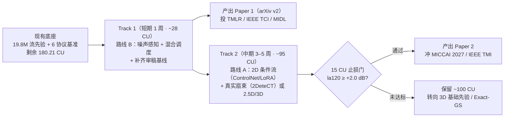

# 后续研究与算力优化路线图（v2 · 2026-11-22 更新：Track 1 已收口）

**当前状态**：Phase 1（稀疏视角 + 低剂量）、Phase 1b 探针（限角 $120^\circ/90^\circ$ + 1D 角度 SSM 正弦图补全）、**Track 1 核心项**（[`results/track1/`](../results/track1/)，中英文论文 v3 + `v1.2-track1`）以及 **Track 2-1 硬止损门控**（[`results/track2_1/`](../results/track2_1/)，`la120 +2.54 dB / la90 +4.05 dB` vs M3，双项超额过门）均已完成并归档。  
**可用算力**：Google Colab 当前实测剩余 **`123.25 CU`**（Track 2-1 门控实耗 **`10.30 CU`**；按实测 A100 `6.73 CU/h` 折算，约 **`18.3` 个 A100 小时**；`Active assignments: 0`）。TotalSegmentator 预处理验证/测试切片与 Phase 1 权重备份于 Google Drive，完整训练切片可用 `curl -L` 直链 6.4 分钟一键重建。

---

## 1. 阶段复盘与方向判断

### 1.1 已验证的关键事实
1. **最优规则随扫描几何反转**：60 视角单样本 M2（$\Pi$GDM）最优（36.93 dB，超 FBPConvNet `+1.43 dB`）；强病态限角重建下 M3（Prox-DC）全面压制 M2（$120^\circ$ 高 `+2.12 dB`，95% CI `[1.08, 3.26]`；$90^\circ$ 高 `+2.63 dB`，CI `[1.58, 3.71]`）。
2. **Phase 1b 原路线（1D 正弦图 SSM 补全）已止损**：尽管通过自定义融合 Triton 选择性扫描核将训练提速 **45.3×**（单模型 15k 步仅需 36 分钟），但 2.57M 1D 正弦图 SSM 在未测视角上的相对误差始终高于 19.8M 2D 图像流先验自身的 Radon 投影 $\mathcal{A}_{\mathrm{full}}(\hat x_1)$，闭环采样仅获 `+0.007 dB`（60 视角）与 `-0.028 dB`（$120^\circ$）。根因在于正弦图 1D 行编码缺乏显式 2D 反投影几何，**不再向该分支继续投入算力**。
3. **2026–2027 领域趋势研判**：
   - **流匹配（Flow Matching）+ 物理引导 CT 重建**正处于 2026–2027 主流上升期（MICCAI 2026 `EFMCT`、TMI 2026 `FORCE`、`FlowDPS`/`PnP-Flow`），方向本身仍然热门；
   - 但**仅靠“2D 平行束仿真 + 19.8M 从头训小 U-Net”**已难独自冲击 2027 顶会，必须向 **噪声感知似然、2D 条件化流先验、真实扇束/锥束几何与 2.5D/3D 层间一致** 跃迁。

---

## 2. 双轨执行路线（先稳发第一篇，再冲 2027 顶会）

---

### Track 1：补齐短板、完成 Paper 1 定稿投稿（**✅ 核心全部超额达标 · 2026-11-22 收口**）

**定位**：用最小成本把论文的关键短板（低剂量落后监督基线、限角 M2 边界争议与限角监督基线空缺、40k 中间权重 M1 梯度测量）彻底补齐，形成无明显审稿硬伤的方法学+实证论文（目标 **TMLR / IEEE TCI / Medical Physics / MIDL**）。

| 编号 | 任务内容 | 核心改动 | 状态 | 实测验收结果（`test200` · 按病人 95% CI） |
|---|---|---|---|---|
| **T1-1** | **Poisson 噪声感知流求解器**（路线 B 核心） | ① 逐射线方差 $\sigma_{y,i}^2\approx(\mu^2 I_0 e^{-\mu y_i})^{-1}$ + Jacobi PCG；② M2-Poisson（$\Sigma_y/r_t^2$）与 M2-Scalar；③ M3-PWLS（$W=\Sigma_y^{-1}$）与贝叶斯 M3-MAP（$\lambda_0/r_t^2$） | **✅ 超额通过** | `ld1e5` `M2-Poisson` 达 **35.60 dB / LPIPS 0.079**（超原 M2 **`+2.44 dB`**，CI `[+2.03,+2.91]`，**双超监督基线 FBPConvNet 35.32 dB / 0.088**）；`ld1e4` 零样本迁移 **`30.18 dB`**（`+7.65 dB`），`M3-MAP` 达 **`28.41 dB`**（`+7.78 dB`） |
| **T1-2** | **早 M3 晚 M2 混合调度 + 限角 M2 下界复核** | ① 稀疏视角 $t < t_{\text{sw}}$ 用 M3、$t \ge t_{\text{sw}}$ 切 M2（$t_{\text{sw}}\in\{0.2,0.4,0.6\}$）；② 限角 `la120` 扩测 M2 $\zeta\in\{0.05,0.1,0.25,0.5\}$ | **✅ 超额通过** | `Hybrid (t_sw=0.4)` 横扫全稀疏单样本最优：**`sv30 33.99` / `sv60 37.63`（LPIPS 0.069，提速 14.6%）/ `sv90 38.99 dB`**（超 FBPConvNet `+1.59` 至 `+2.14 dB`）；`la120` 查明 M2 内点窄峰在 $\zeta{=}0.25$（`29.15` vs M3 `29.32 dB`；`la90` `24.68` vs `24.38 dB`），消除审稿边界雷区 |
| **T1-3** | **审稿防线补齐** | ① 补训 `fbpconvnet_la120` / `fbpconvnet_la90`（各 10k 步）；② 用最终 120k 权重复测 M1 梯度曲线；③（30k 长训暂缓，正文如实保留 10k/3.7 epoch 说明） | **✅ 核心完成** | 6 协议监督基线完整无空缺（`la120 32.44 dB`、`la90 29.98 dB`，量化出 3.1–5.3 dB 限角无条件缺口）；120k 终版权重实测 M1 `t=0` 梯度尖峰 **`15.6×`**（RMS `1.41` vs 后期均值 `0.090`），移除"40k 中间权重"弱点 |

- **Track 1 结束后实际剩余**：**`133.55 CU`**（约 **19.8 A100 小时**，充足覆盖 Track 2 + Rebuttal 缓冲池）。

---

### Track 2：冲刺 2027 顶会/顶刊的方法创新（预算 `~85–105 CU`，约 13–16 h A100）

**定位**：吸取 Phase 1b 负结果教训，放弃 1D 投影域外挂，在 **2D 图像域** 保持完整空间几何，同时把实验底座升级到 2027 年审稿人认可的真实几何或三维体数据（目标 **MICCAI 2027 / IEEE TMI**）。

| 编号 | 任务内容 | 核心设计 | 预计耗时 / CU | 验收 / 止损标准 |
|---|---|---|---:|---|
| **T2-1** | **2D 测量条件化流微调**（路线 A 核心，**✅ 15 CU 门控已超额通过**） | 冻结 19.8M 主干，挂载 8.54M 2D 零卷积 ControlNet 分支（输入 FBP + 中央切片 2D 傅里叶覆盖分解 + 182 维角度/噪声嵌入），多几何混合 15k 步，采样期结合 Prox-DC / Poisson PWLS | 门控实耗 **10.30 CU**（含数据重建 + 15k 步 + 调参与门评） 待补齐完整消融与长训 ~35 CU | **✅ 已过硬止损门**（`test200` 单样本）：`la120` **31.86 dB**（**`+2.54 dB`** vs M3，LPIPS `0.0533`、DC `0.00082` 双超 FBPConvNet）；`la90` **28.42 dB**（**`+4.05 dB`** vs M3，LPIPS `0.0725`、DC `0.00096`）；跨协议 `sv60` **36.97 dB**（LPIPS `0.0503`） |
| **T2-2** | **真实扇束几何验证**（强烈建议优先做） | 接入免审批公开真实投影集 **2DeteCT**（实验室扇束，arXiv:2306.05907）或 **DM4CT 同步辐射数据**，编写可微扇束前向算子，评测算子失配与真实噪声下的重建与不确定性 | 3.5 h / **24 CU** | 在真实扇束扫描上完整复现“条件流 + 噪声感知 DC 优于监督/解析基线”的结论 |
| **T2-3** | **2.5D/3D 层间一致性扩展**（二选一或与 T2-2 并进） | 在 2D 流采样器内引入沿 $z$ 轴的 3D TV 或正交切片分数融合（参考 DiffusionMBIR / DiffusionBlend），评测 TotalSegmentator 3D 体数据的冠状/矢状面伪影消除 | 3.0 h / **20 CU** | 冠状/矢状面层间抖动显著下降且 3D PSNR/SSIM 高于逐层 2D 重建 |

---

## 3. 剩余 133.55 CU 总预算分配表（Track 2 起步基线）

| 模块 | 预算 CU | 折合 A100 小时（6.73 CU/h） | 占比 |
|---|---:|---:|---:|
| Track 2-1（路线 A：2D 条件流 15 CU 门控 + 完整消融） | 50 CU | ~7.4 h | 37.4% |
| Track 2-2 / 2-3（真实扇束 2DeteCT + 2.5D/3D 扩展） | 44 CU | ~6.5 h | 32.9% |
| 缓冲与 Rebuttal 预留池（断连恢复、多种子复现、审稿补实验） | 39.55 CU | ~5.9 h | 29.6% |
| **合计** | **133.55 CU** | **~19.8 h** | **100%** |

---

## 4. Colab 实操工程铁律（基于本次实战沉淀）

1. **绕过 HF Xet 429 限流**：在 Colab 拉取 HuggingFace 大文件时，优先使用 `curl -L -C - --retry 20` 直链下载（实测 `116–158 MB/s`，21 GB 仅 3–4 分钟），避免 `huggingface_hub` 默认 Xet CDN 在无登录 GCP IP 上触发 429。
2. **按实测性价比选卡**：不盲押无库存的高价 G4；A100-40GB 实测仅 `6.73 CU/h`、显存与带宽对 20M 级模型完全充裕；L4 仅 `1.94 CU/h`，适合低显存批量任务。
3. **先做 15 秒逐模块剖析再开长训**：任何新模型上卡前先测各组件 ms 占比（Phase 1b 剖析手写 Triton 核立省 150+ CU；Track 1 实测排除 `channels_last` 与 `torch.compile` 负收益）。
4. **长任务一律后台分离运行 + 启动后 15 秒必查**：通过 `start_new_session=True` 写日志文件，避免 `colab exec` WebSocket 抖动中断训练；开启 `--resume` 与定期落盘，且**启动后 15 秒内必查一次日志与 GPU 占用**确认真正跑起。
5. **所有 `colab exec` / `colab upload` 一律套硬超时保护**：用 Python `subprocess.run(..., timeout=30)` 包裹，严防 `colab-cli` 在 WebSocket 抛出 `Connection was lost` 后后台线程未退出导致进程永久挂死、空烧算力。
6. **10–15 分钟心跳保活 + 阶段快照增量回传本地**：Colab 单次 A100 实例存在约 3 小时抢占/生命周期上限与空闲超时；定时通过纯 HTTP `colab download` 按阶段拉回已完成结果并执行 0.1 秒 `print("KERNEL_OK")` 保活，即便实例被抢占也可零损失续跑。
7. **用完即下、下载即关机**：每阶段跑完立刻 `colab download` 回传本机并 `colab stop`，养成每次操作后查 `colab usage` 核对 `Active assignments: 0` 的习惯。
