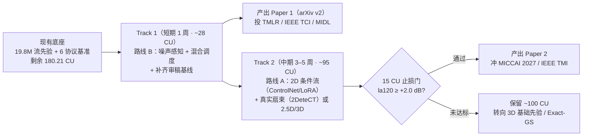

# 后续研究与算力优化路线图（v2 · 2026-11-21）

**基线状态**：Phase 1（稀疏视角 + 低剂量）与 Phase 1b 探针（限角 $120^\circ/90^\circ$ + 1D 角度 SSM 正弦图补全）均已完成并归档；中英文论文已重写编译至终版（含架构图、限角定性图与探针诊断图）。  
**可用算力**：Google Colab 剩余 **`180.21 CU`**（按实测 A100 `6.73 CU/h` 折算，约 **`26.8` 个 A100 小时**）；TotalSegmentator 预处理切片（`6.1 GB`）与 Phase 1 校验权重（`379 MB`）已备份于 Google Drive。

---

## 1. 阶段复盘与方向判断

### 1.1 已验证的关键事实
1. **最优规则随扫描几何反转**：60 视角单样本 M2（$\Pi$GDM）最优（36.93 dB，超 FBPConvNet `+1.43 dB`）；强病态限角重建下 M3（Prox-DC）全面压制 M2（$120^\circ$ 高 `+2.12 dB`，95% CI `[1.08, 3.26]`；$90^\circ$ 高 `+2.63 dB`，CI `[1.58, 3.71]`）。
2. **Phase 1b 原路线（1D 正弦图 SSM 补全）已止损**：尽管通过自定义融合 Triton 选择性扫描核将训练提速 **45.3×**（单模型 15k 步仅需 36 分钟），但 2.57M 1D 正弦图 SSM 在未测视角上的相对误差始终高于 19.8M 2D 图像流先验自身的 Radon 投影 $\mathcal{A}_{\mathrm{full}}(\hat x_1)$，闭环采样仅获 `+0.007 dB`（60 视角）与 `-0.028 dB`（$120^\circ$）。根因在于正弦图 1D 行编码缺乏显式 2D 反投影几何，**不再向该分支继续投入算力**。
3. **2026–2027 领域趋势研判**：
   - **流匹配（Flow Matching）+ 物理引导 CT 重建**正处于 2026–2027 主流上升期（MICCAI 2026 `EFMCT`、TMI 2026 `FORCE`、`FlowDPS`/`PnP-Flow`），方向本身仍然热门；
   - 但**仅靠“2D 平行束仿真 + 19.8M 从头训小 U-Net”**已难独自冲击 2027 顶会，必须向 **噪声感知似然、2D 条件化流先验、真实扇束/锥束几何与 2.5D/3D 层间一致** 跃迁。

---

## 2. 双轨执行路线（先稳发第一篇，再冲 2027 顶会）

---

### Track 1：补齐短板、完成 Paper 1 定稿投稿（预算 `~25–30 CU`，约 4 h A100）

**定位**：不强行堆叠新模块，而是用最小成本把当前论文的最后两处短板（低剂量输给监督基线、FBPConvNet 训练轮数与限角空缺）彻底补齐，形成一篇无明显审稿硬伤的方法学+实证论文（目标 **TMLR / IEEE TCI / Medical Physics / MIDL**）。

| 编号 | 任务内容 | 核心改动 | 预计耗时 / CU | 验收 / 止损标准 |
|---|---|---|---:|---|
| **T1-1** | **Poisson 噪声感知流求解器**（路线 B 核心） | ① 在 `weighted_cg_dc` 中接入逐射线逆方差权重 $W_i \propto I_0 e^{-\mu y_i}$；② 在 M2 中启用噪声项 $\sigma_y^2 / r_t^2$（由 $I_0$ 解析估计）；③ 在 `ld1e5` 与 `ld1e4` 上重测 | 1.2 h / **8 CU** | `ld1e5` 较现有 M2（33.16 dB）提升 **$\ge +1.8$ dB**，逼近或超越 FBPConvNet（35.32 dB） |
| **T1-2** | **早 M3 晚 M2 混合调度 + 限角 M2 下界复核** | ① 稀疏视角测试 $t < t_{\text{sw}}$ 用 M3 稳结构、$t \ge t_{\text{sw}}$ 切 M2 锐化边缘（$t_{\text{sw}}\in\{0.2,0.4,0.6\}$）；② 限角 `la120` 补测 M2 $\zeta\in\{0.1,0.25\}$ 消除网格边界争议 | 1.0 h / **7 CU** | 稀疏单样本追平或超过纯 M2（36.93 dB）且速度更快；限角 M2 确认非边界最优 |
| **T1-3** | **审稿防线补齐** | ① 补训 `fbpconvnet_la120` / `fbpconvnet_la90`（配置已就绪）；② 对 `sv60` + `ld1e5` 跑 30k 步长训 FBPConvNet；③ 用最终 120k 权重复测 M1 梯度曲线 | 2.0 h / **13 CU** | 主表 6 协议监督基线完整无空缺；正文移除"3.7 epoch 下界"与"40k 中间权重"两项弱点 |

- **Track 1 结束后预计剩余**：**`~150 CU`**（约 **22.3 A100 小时**）。

---

### Track 2：冲刺 2027 顶会/顶刊的方法创新（预算 `~85–105 CU`，约 13–16 h A100）

**定位**：吸取 Phase 1b 负结果教训，放弃 1D 投影域外挂，在 **2D 图像域** 保持完整空间几何，同时把实验底座升级到 2027 年审稿人认可的真实几何或三维体数据（目标 **MICCAI 2027 / IEEE TMI**）。

| 编号 | 任务内容 | 核心设计 | 预计耗时 / CU | 验收 / 止损标准 |
|---|---|---|---:|---|
| **T2-1** | **2D 测量条件化流微调**（路线 A 核心，先跑门控） | 冻结 19.8M 主干，挂载轻量 2D 零卷积条件分支（ControlNet / LoRA，输入 FBP + 角度覆盖频率掩码），或训练 FBP→Clean 的 Rectified Bridge Flow，采样期结合 T1-1 的噪声感知 Prox-DC | 先投 2.2 h / **15 CU**（10k 步门控） 通过后补齐消融 5.5 h / **37 CU** | **硬止损门**：`la120` 较 M3（29.32 dB）提升 **$< +2.0$ dB** 或 `la90`（24.38 dB）提升 **$< +2.5$ dB** 则立刻停训复盘 |
| **T2-2** | **真实扇束几何验证**（强烈建议优先做） | 接入免审批公开真实投影集 **2DeteCT**（实验室扇束，arXiv:2306.05907）或 **DM4CT 同步辐射数据**，编写可微扇束前向算子，评测算子失配与真实噪声下的重建与不确定性 | 3.5 h / **24 CU** | 在真实扇束扫描上完整复现“条件流 + 噪声感知 DC 优于监督/解析基线”的结论 |
| **T2-3** | **2.5D/3D 层间一致性扩展**（二选一或与 T2-2 并进） | 在 2D 流采样器内引入沿 $z$ 轴的 3D TV 或正交切片分数融合（参考 DiffusionMBIR / DiffusionBlend），评测 TotalSegmentator 3D 体数据的冠状/矢状面伪影消除 | 3.0 h / **20 CU** | 冠状/矢状面层间抖动显著下降且 3D PSNR/SSIM 高于逐层 2D 重建 |

---

## 3. 剩余 180.21 CU 总预算分配表

| 模块 | 预算 CU | 折合 A100 小时（6.73 CU/h） | 占比 |
|---|---:|---:|---:|
| Track 1（路线 B 求解器 + 审稿基线补齐） | 28 CU | ~4.2 h | 15.5% |
| Track 2-1（路线 A：2D 条件流门控 + 完整消融） | 52 CU | ~7.7 h | 28.9% |
| Track 2-2 / 2-3（真实扇束几何 + 2.5D/3D 扩展） | 44 CU | ~6.5 h | 24.4% |
| 缓冲与 Rebuttal 预留池（断连恢复、多种子复现、审稿补实验） | 56 CU | ~8.3 h | 31.2% |
| **合计** | **180 CU** | **~26.7 h** | **100%** |

---

## 4. Colab 实操工程铁律（基于本次实战沉淀）

1. **绕过 HF Xet 429 限流**：在 Colab 拉取 HuggingFace 大文件时，优先使用 `curl -L -C - --retry 20` 直链下载（实测 `116 MB/s`，21 GB 仅 4 分钟），避免 `huggingface_hub` 默认 Xet CDN 在无登录 GCP IP 上触发 429。
2. **按实测性价比选卡**：不盲押无库存的高价 G4；A100-40GB 实测仅 `6.73 CU/h`、显存与带宽对 20M 级模型完全充裕。
3. **先做 15 秒逐模块剖析再开长训**：任何新模型上卡前先测各组件 ms 占比（本次剖析发现 Python 循环占 94% 耗时，手写 Triton 核立省 150+ CU）。
4. **长任务一律后台分离运行**：通过 `start_new_session=True` 写日志文件，避免 `colab exec` WebSocket 抖动或 30s 静默超时中断训练；开启 `--resume` 与每 1000 步落盘。
5. **用完即下、下载即关机**：每阶段跑完立刻 `colab download` 回传本机并 `colab stop`，养成每次操作后查 `colab usage` 核对 `Active assignments: 0` 的习惯。
